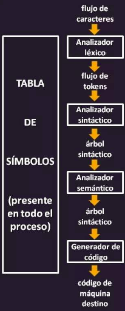
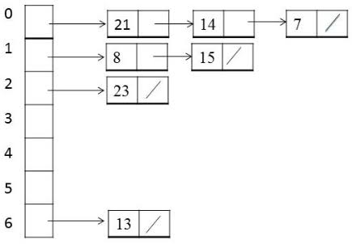

# TABLA DE SÍMBOLOS

## AUTÓMATAS Y COMPILADORES

Proyecto académico sobre las tablas de símbolos
y su funcionamiento dentro de los compiladores.

---

## Contenido

1. Introducción
2. Definición
3. Características
4. Operaciones
5. Estructuras de datos
6. Ámbitos
7. Caso práctico
8. Conclusiones
9. Bibliografía

---

# 1. Introducción

La **tabla de símbolos** es una estructura de datos
utilizada durante el proceso de compilación.

Un compilador traduce un programa fuente a otro lenguaje
y lo hace por fases:

- Análisis léxico
- Análisis sintáctico
- Análisis semántico
- Generación de código intermedio
- Optimización
- Generación de código objeto

En todas estas fases el compilador necesita recordar
qué nombres aparecen en el programa y qué significan.
Esa información se guarda en la tabla de símbolos.

> **Fuente:** Aho, A. V., Lam, M. S., Sethi, R. y Ullman, J. D. (2008).
> *Compiladores: principios, técnicas y herramientas* (2.ª ed.; A. Vidal Romero Elizondo, Trad.).
> Pearson Educación.

---

## Relación con los autómatas

El analizador léxico se construye con **autómatas finitos**.
El autómata reconoce que `contador` es un identificador válido,
pero no recuerda si ya se declaró ni de qué tipo es.

Esa información se guarda en la tabla de símbolos,
que funciona como **puente** entre el análisis léxico
y el análisis semántico.

> **Fuente:** Louden, K. C. (2004).
> *Construcción de compiladores: principios y práctica* (E. Alatorre Miguel, Trad.).
> International Thomson Editores.

---

<p align="center">
  
</p>

> **Fuente:** Usuario Perú. (22 de julio de 2019).
> *Cómo funciona un compilador*.
> https://usuarioperu.com/2019/07/22/como-funciona-un-compilador/

## Herramientas generadoras

Herramientas como Lex/Yacc, JFlex/Cup o JavaCC
generan el analizador léxico y el sintáctico,
pero **no generan la tabla de símbolos**.

El programador debe implementarla y usarla
desde las acciones semánticas.

> **Fuente:** Gálvez Rojas, S. y Mora Mata, M. Á. (2005).
> *Java a tope: Traductores y compiladores con Lex/Yacc, JFlex/Cup y JavaCC* (Ed. electrónica).
> Universidad de Málaga.

---

# 2. Definición

La tabla de símbolos es una **estructura de datos**
que guarda información sobre los identificadores
del programa fuente.

Cada entrada relaciona un nombre con sus atributos:

- **Nombre:** el lexema, por ejemplo `suma`
- **Categoría:** variable, constante, función o parámetro
- **Tipo:** `int`, `float`, `boolean`, etc.
- **Ámbito:** global, local o de bloque
- **Dirección:** posición o desplazamiento en memoria
- **Parámetros:** número y tipo, si es una función

> **Fuente:** Aho, A. V., Lam, M. S., Sethi, R. y Ullman, J. D. (2008).
> *Compiladores: principios, técnicas y herramientas* (2.ª ed.; A. Vidal Romero Elizondo, Trad.).
> Pearson Educación.

---

## La tabla como diccionario

La tabla de símbolos funciona como un **diccionario**:

- La palabra que se busca es el nombre del identificador.
- La definición son sus atributos.
- Debe permitir agregar, buscar y borrar de forma rápida.

Ejemplo:

- `x` → variable, `int`, global
- `suma` → función, recibe `(int, int)` y devuelve `float`

> **Fuente:** Louden, K. C. (2004).
> *Construcción de compiladores: principios y práctica* (E. Alatorre Miguel, Trad.).
> International Thomson Editores.

---

# 3. Características

## Es compartida por todas las fases

- El analizador léxico o sintáctico **crea** las entradas.
- El analizador semántico **agrega y verifica** los tipos.
- El generador de código **consulta** direcciones y tamaños.

> **Fuente:** Aho, A. V., Lam, M. S., Sethi, R. y Ullman, J. D. (2008).
> *Compiladores: principios, técnicas y herramientas* (2.ª ed.; A. Vidal Romero Elizondo, Trad.).
> Pearson Educación.

## Es eficiente y dinámica

- Se consulta cada vez que aparece un identificador,
  por eso debe ser **rápida**.
- **Crece** conforme aparecen declaraciones.
- Al salir de un bloque se **borran** las variables locales.

> **Fuente:** Louden, K. C. (2004).
> *Construcción de compiladores: principios y práctica* (E. Alatorre Miguel, Trad.).
> International Thomson Editores.

## Depende del lenguaje

Los atributos que se guardan cambian según
lo que el lenguaje necesite verificar y traducir.

> **Fuente:** Gálvez Rojas, S. y Mora Mata, M. Á. (2005).
> *Java a tope: Traductores y compiladores con Lex/Yacc, JFlex/Cup y JavaCC* (Ed. electrónica).
> Universidad de Málaga.

---

# 4. Operaciones

## Operaciones básicas

- **Insertar:** agrega un nombre con sus atributos.
  Se usa al encontrar una declaración como `int x;`
- **Buscar:** devuelve los atributos de un nombre
  o indica que no existe. Se usa en cada uso, como `x = 5;`
- **Eliminar:** quita los nombres que dejan de ser visibles.
  Se usa al terminar un bloque o una función.

Antes de insertar, el compilador busca en el ámbito actual
para detectar si la variable ya fue declarada.

> **Fuente:** Louden, K. C. (2004).
> *Construcción de compiladores: principios y práctica* (E. Alatorre Miguel, Trad.).
> International Thomson Editores.

## Operaciones de ámbito

- **Entrar a un ámbito:** se abre un nuevo nivel en la tabla.
- **Salir de un ámbito:** se borran las declaraciones locales
  y se regresa al nivel anterior.

> **Fuente:** Aho, A. V., Lam, M. S., Sethi, R. y Ullman, J. D. (2008).
> *Compiladores: principios, técnicas y herramientas* (2.ª ed.; A. Vidal Romero Elizondo, Trad.).
> Pearson Educación.

## Actualizar atributos

El analizador léxico puede guardar solo el nombre
y después el analizador semántico **completa**
el tipo y la dirección.

> **Fuente:** Gálvez Rojas, S. y Mora Mata, M. Á. (2005).
> *Java a tope: Traductores y compiladores con Lex/Yacc, JFlex/Cup y JavaCC* (Ed. electrónica).
> Universidad de Málaga.

---

# 5. Estructuras de datos

## Opciones de implementación

- **Lista lineal:** búsqueda O(n).
  Fácil de programar, pero lenta con muchos nombres.
- **Árbol binario de búsqueda:** búsqueda O(log n).
  Mantiene los nombres ordenados, pero puede desbalancearse.
- **Tabla hash:** búsqueda O(1) en promedio.
  Es la más rápida y la más usada en compiladores.

> **Fuente:** Louden, K. C. (2004).
> *Construcción de compiladores: principios y práctica* (E. Alatorre Miguel, Trad.).
> International Thomson Editores.

## Tabla hash con encadenamiento

- Una **función hash** convierte el nombre en una posición.
- Cada posición (**cubeta**) apunta a una lista de entradas.
- Si dos nombres caen en la misma cubeta, se encadenan.

La nueva declaración se inserta al inicio de la lista,
así la búsqueda encuentra primero la más interna.

<p align="center">
  
</p>

> **Fuente:** *Hash table representation for separate chaining* [Figura]. ResearchGate.
> https://www.researchgate.net/figure/Hash-table-representation-for-separate-chaining_fig2_284454241

> **Fuente:** Louden, K. C. (2004).
> *Construcción de compiladores: principios y práctica* (E. Alatorre Miguel, Trad.).
> International Thomson Editores.

## Una tabla por ámbito

Cada ámbito tiene su propia tabla, enlazada
con la tabla del ámbito que la contiene.
La búsqueda va del ámbito actual **hacia afuera**.

> **Fuente:** Aho, A. V., Lam, M. S., Sethi, R. y Ullman, J. D. (2008).
> *Compiladores: principios, técnicas y herramientas* (2.ª ed.; A. Vidal Romero Elizondo, Trad.).
> Pearson Educación.

En Java esto se implementa con `HashMap` o `Hashtable`.

> **Fuente:** Gálvez Rojas, S. y Mora Mata, M. Á. (2005).
> *Java a tope: Traductores y compiladores con Lex/Yacc, JFlex/Cup y JavaCC* (Ed. electrónica).
> Universidad de Málaga.

---

# 6. Ámbitos

## Definición de ámbito

El **ámbito** es la parte del programa
donde una declaración es visible.

La tabla de símbolos aplica las reglas de ámbito
para relacionar cada uso de un nombre
con su declaración correcta.

> **Fuente:** Aho, A. V., Lam, M. S., Sethi, R. y Ullman, J. D. (2008).
> *Compiladores: principios, técnicas y herramientas* (2.ª ed.; A. Vidal Romero Elizondo, Trad.).
> Pearson Educación.

## Tipos de ámbito

- **Estático:** se decide por cómo está escrito el programa.
  Lo usan C, Java y Pascal.
- **Dinámico:** depende del orden de las llamadas
  en tiempo de ejecución.

Niveles típicos:

- **Global:** todo el programa
- **De función:** parámetros y variables locales
- **De bloque:** lo que está entre llaves

> **Fuente:** Louden, K. C. (2004).
> *Construcción de compiladores: principios y práctica* (E. Alatorre Miguel, Trad.).
> International Thomson Editores.

## Regla del anidamiento más cercano

> [!IMPORTANT]
> Si un nombre se declara en varios bloques,
> gana la declaración del **bloque más interno**.

- `int x = 1;` → x global
- `void f() {`
- `int x = 2;` → oculta a la x global
- `printf("%d", x);` → imprime 2
- `}`

> **Fuente:** Aho, A. V., Lam, M. S., Sethi, R. y Ullman, J. D. (2008).
> *Compiladores: principios, técnicas y herramientas* (2.ª ed.; A. Vidal Romero Elizondo, Trad.).
> Pearson Educación.

---

# 7. Caso práctico

## Programa a analizar

- `int x;` → nivel 0 (global)
- `float suma(int a, int b) {` → nivel 1 (función)
- `float x;` → oculta a la x global
- `x = a + b;`
- `{`
- `int i;` → nivel 2 (bloque)
- `i = 0;`
- `}`
- `return x;`
- `}`

> **Fuente:** Aho, A. V., Lam, M. S., Sethi, R. y Ullman, J. D. (2008).
> *Compiladores: principios, técnicas y herramientas* (2.ª ed.; A. Vidal Romero Elizondo, Trad.).
> Pearson Educación.

## Paso a paso

1. `int x;` → inserta `x` (int) en el nivel global.
2. `float suma(int a, int b)` → inserta `suma`,
   entra al nivel 1 e inserta `a` y `b`.
3. `float x;` → no existe en el nivel 1, se inserta
   y oculta a la `x` global.
4. `x = a + b;` → encuentra `x`, `a` y `b` en el nivel 1
   y verifica que los tipos sean compatibles.
5. `{ int i; }` → entra al nivel 2, inserta `i`
   y al cerrar la llave elimina ese nivel.
6. `return x;` → encuentra la `x` de tipo `float`.
7. Fin de la función → elimina el nivel 1.

> **Fuente:** Louden, K. C. (2004).
> *Construcción de compiladores: principios y práctica* (E. Alatorre Miguel, Trad.).
> International Thomson Editores.

## Contenido de la tabla en el bloque interno

- `i` → variable local, `int`, nivel 2
- `a` → parámetro, `int`, nivel 1
- `b` → parámetro, `int`, nivel 1
- `x` → variable local, `float`, nivel 1
- `x` → variable global, `int`, nivel 0
- `suma` → función `(int, int)` → `float`, nivel 0

> **Fuente:** Aho, A. V., Lam, M. S., Sethi, R. y Ullman, J. D. (2008).
> *Compiladores: principios, técnicas y herramientas* (2.ª ed.; A. Vidal Romero Elizondo, Trad.).
> Pearson Educación.

## Errores que detecta

> [!WARNING]
> **No declarada:** usar `i` fuera de su bloque.
>
> **Redeclarada:** escribir `int a;` dentro de `suma`.

> **Fuente:** Louden, K. C. (2004).
> *Construcción de compiladores: principios y práctica* (E. Alatorre Miguel, Trad.).
> International Thomson Editores.

## Implementación en Java

- `Simbolo` → clase con `nombre`, `categoria` y `tipo`
- `Deque<HashMap<String, Simbolo>>` → pila de ámbitos
- `entrarAmbito()` → `ambitos.push(new HashMap<>())`
- `salirAmbito()` → `ambitos.pop()`
- `insertar()` → revisa redeclaración y hace `put`
- `buscar()` → recorre del nivel interno al global

> **Fuente:** Gálvez Rojas, S. y Mora Mata, M. Á. (2005).
> *Java a tope: Traductores y compiladores con Lex/Yacc, JFlex/Cup y JavaCC* (Ed. electrónica).
> Universidad de Málaga.

## Compilar y ejecutar

Requiere un **JDK 17 o superior**. Los comandos se ejecutan
desde la raíz del repositorio.

**Linux**

```bash
javac -encoding UTF-8 -d out Practica_sencilla/*.java Practica_sencilla/gui/*.java
java -cp out Practica_sencilla.gui.Main    # interfaz gráfica
java -cp out Practica_sencilla.Main        # consola
```

**Windows (PowerShell o CMD)**

```bat
javac -encoding UTF-8 -d out Practica_sencilla\*.java Practica_sencilla\gui\*.java
java -cp out Practica_sencilla.gui.Main
java -cp out Practica_sencilla.Main
```

**Opcional: generar un `.jar`** (Linux y Windows)

```bash
jar cfe Practica.jar Practica_sencilla.gui.Main -C out .
java -jar Practica.jar
```

---

# 8. Conclusiones

- La tabla de símbolos **une todas las fases** del compilador.
- Sus operaciones principales son **insertar, buscar y eliminar**.
- La **tabla hash** es la estructura más eficiente.
- Permite detectar variables **no declaradas** o **redeclaradas**.

> **Fuente:** Aho, A. V., Lam, M. S., Sethi, R. y Ullman, J. D. (2008).
> *Compiladores: principios, técnicas y herramientas* (2.ª ed.; A. Vidal Romero Elizondo, Trad.).
> Pearson Educación.

> **Fuente:** Louden, K. C. (2004).
> *Construcción de compiladores: principios y práctica* (E. Alatorre Miguel, Trad.).
> International Thomson Editores.

- Con JFlex/Cup o JavaCC la tabla se programa a mano,
  por eso entenderla es **necesario** para construir un compilador.

> **Fuente:** Gálvez Rojas, S. y Mora Mata, M. Á. (2005).
> *Java a tope: Traductores y compiladores con Lex/Yacc, JFlex/Cup y JavaCC* (Ed. electrónica).
> Universidad de Málaga.

---

# 9. Bibliografía

- Aho, A. V., Lam, M. S., Sethi, R. y Ullman, J. D. (2008).
  *Compiladores: principios, técnicas y herramientas* (2.ª ed.; A. Vidal Romero Elizondo, Trad.).
  Pearson Educación.
  [Registro del libro](https://biblioteca.frro.utn.edu.ar/bib/557)

- Gálvez Rojas, S. y Mora Mata, M. Á. (2005).
  *Java a tope: Traductores y compiladores con Lex/Yacc, JFlex/Cup y JavaCC* (Ed. electrónica).
  Universidad de Málaga.
  [Datos del libro](https://pt.slideshare.net/slideshow/java-a-tope/13532689)

- Louden, K. C. (2004).
  *Construcción de compiladores: principios y práctica* (E. Alatorre Miguel, Trad.).
  International Thomson Editores.
  [Registro del libro](https://catalogosiidca.csuca.org/Record/UP.101395?lng=en)
